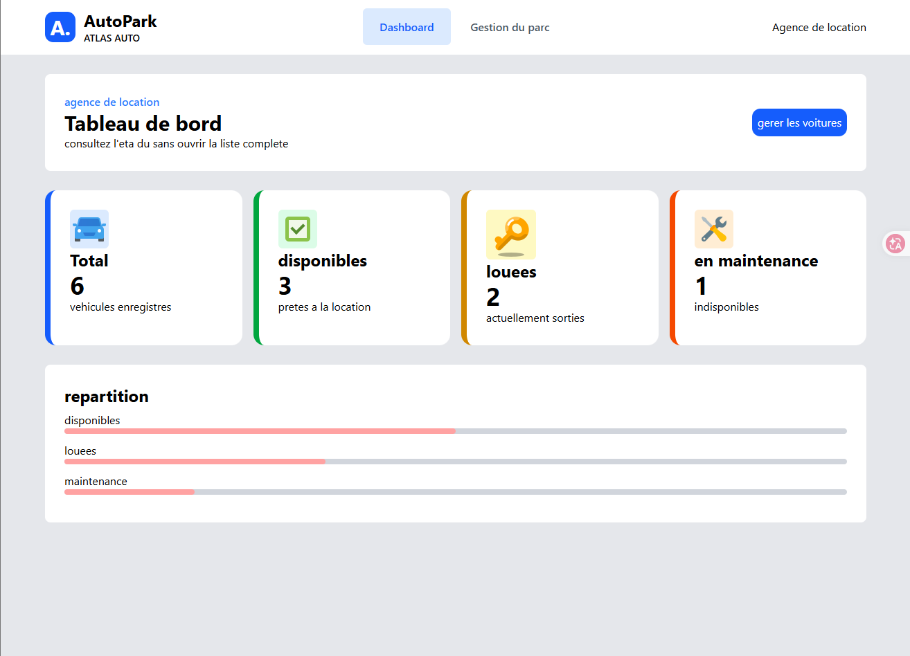
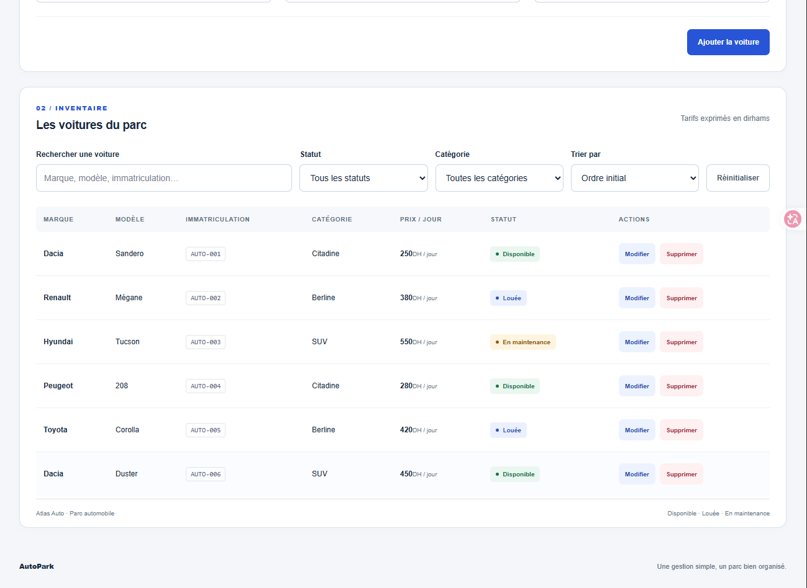
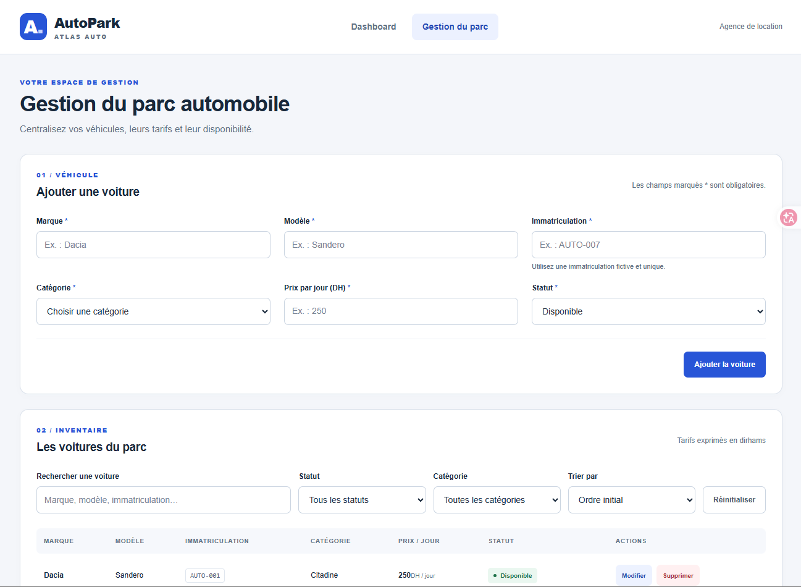
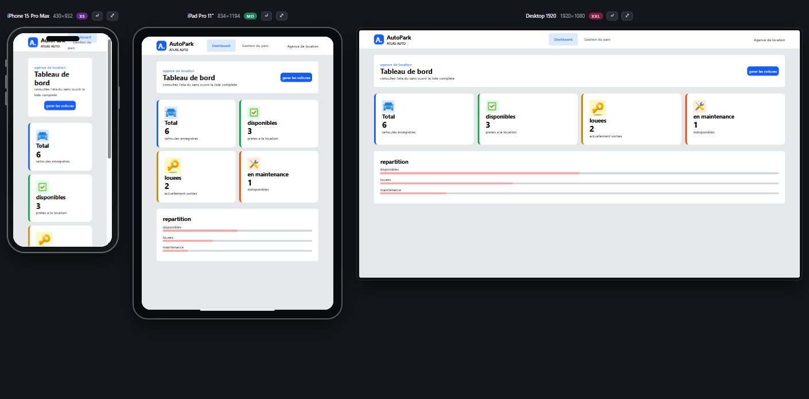
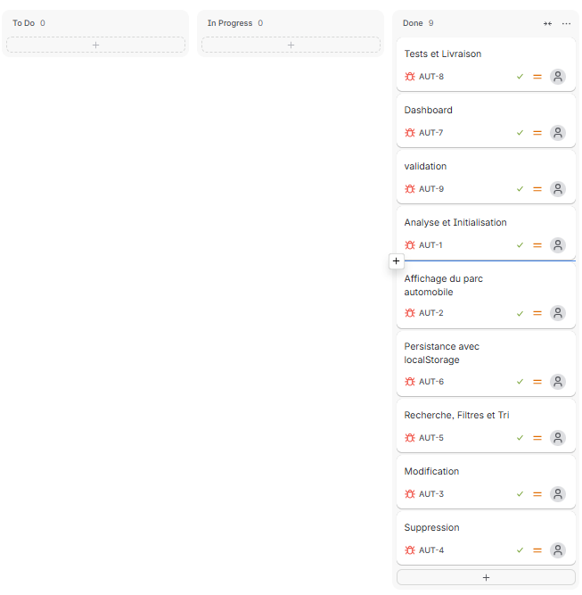

# 🚗 AutoPark — Gestion de Parc Automobile

## 📌 Description du projet

**AutoPark** est une application web interactive et responsive développée pour **Atlas Auto**, une agence fictive de location de voitures.

L'application permet de gérer un parc automobile à travers une interface simple et intuitive. Elle offre la possibilité de consulter, ajouter, modifier et supprimer des véhicules, tout en suivant leur disponibilité et leurs tarifs.

Le projet comprend deux pages principales :

- **Dashboard** : vue d'ensemble du parc automobile avec des statistiques dynamiques.
- **Gestion du parc** : interface permettant de gérer les véhicules et leurs informations.

AutoPark est développé avec **HTML5, CSS3 et JavaScript Vanilla ES6+**, sans framework ni backend.

Les données sont sauvegardées localement dans le navigateur grâce à **localStorage**.

---

## 🎯 Objectifs du projet

- Développer une application de gestion automobile responsive.
- Manipuler le DOM avec JavaScript.
- Implémenter les opérations CRUD.
- Utiliser les tableaux d'objets JavaScript.
- Exploiter les fonctionnalités modernes d'ES6+.
- Organiser le code en modules JavaScript.
- Implémenter la recherche, les filtres et le tri.
- Valider les formulaires et gérer les erreurs.
- Sauvegarder les données avec localStorage.
- Créer un dashboard avec des statistiques dynamiques.
- Utiliser Git, GitHub et Jira pour organiser le projet.

---

## ✨ Fonctionnalités

### 📊 1. Dashboard

Le dashboard permet de visualiser les statistiques du parc automobile.

Il affiche quatre indicateurs :

- 🚗 **Total des voitures** : nombre total de véhicules.
- ✅ **Disponibles** : nombre de voitures disponibles.
- 🔑 **Louées** : nombre de voitures actuellement louées.
- 🔧 **En maintenance** : nombre de voitures en maintenance.

Les statistiques sont calculées automatiquement à partir des données sauvegardées et actualisées à chaque chargement de la page.

### 🚘 2. Gestion du parc automobile

Les véhicules sont affichés dynamiquement dans un tableau HTML.

Chaque véhicule possède :

- Un identifiant unique.
- Une marque.
- Un modèle.
- Une immatriculation unique.
- Une catégorie.
- Un prix journalier en DH.
- Un statut de disponibilité.

**Catégories disponibles :**
- Citadine
- Berline
- SUV

**Statuts disponibles :**
- Disponible
- Louée
- En maintenance

Les statuts sont différenciés visuellement pour faciliter leur identification.

### ➕ 3. Ajout d'une voiture

L'utilisateur peut ajouter une nouvelle voiture à travers un formulaire.

Les validations comprennent :

- Vérification des champs obligatoires.
- Refus des champs contenant uniquement des espaces.
- Vérification d'un prix strictement positif.
- Vérification de l'unicité de l'immatriculation.
- Comparaison des immatriculations sans tenir compte de la casse ni des espaces autour.
- Affichage des messages d'erreur près des champs.

Après un ajout valide :

- La voiture est ajoutée au tableau.
- Les données sont sauvegardées.
- Un message de confirmation apparaît.
- Le formulaire est réinitialisé.

### ✏️ 4. Modification d'une voiture

Chaque véhicule possède un bouton **Modifier**.

Cette fonctionnalité permet de :

- Préremplir le formulaire avec les données existantes.
- Modifier les informations du véhicule.
- Conserver son identifiant.
- Vérifier les données avant enregistrement.
- Empêcher les immatriculations en doublon.
- Enregistrer les modifications sans recharger la page.
- Annuler la modification grâce au bouton **Annuler**.

### 🗑️ 5. Suppression d'une voiture

Chaque véhicule possède un bouton **Supprimer**.

Avant la suppression :

1. Une confirmation est demandée.
2. L'utilisateur peut confirmer ou annuler.
3. Si la suppression est confirmée, le véhicule est retiré.
4. Le tableau est actualisé.
5. Les modifications sont sauvegardées dans localStorage.

### 🔍 6. Recherche instantanée

L'application permet de rechercher une voiture par :

- Marque.
- Modèle.
- Immatriculation.

La recherche est instantanée et insensible à la casse.

### 🏷️ 7. Filtres

Les utilisateurs peuvent filtrer les véhicules selon :

**Catégorie :**
- Citadine
- Berline
- SUV

**Statut :**
- Disponible
- Louée
- En maintenance

Les filtres peuvent être utilisés simultanément avec la recherche et le tri.

### 🔃 8. Tri des véhicules

Les véhicules peuvent être triés selon leur prix journalier :

- Prix croissant.
- Prix décroissant.

Un bouton permet de réinitialiser les critères de recherche, de filtrage et de tri.

Un message est affiché lorsqu'aucun véhicule ne correspond aux critères sélectionnés.

### 💾 9. Sauvegarde avec localStorage

Les données sont automatiquement enregistrées dans le navigateur après chaque :

- Ajout.
- Modification.
- Suppression.

Au chargement de l'application :

- Les données sauvegardées sont récupérées.
- Les données initiales sont utilisées uniquement lorsqu'aucune sauvegarde n'existe.
- Un parc volontairement vidé reste vide après rechargement.

---

## 🛠️ Technologies utilisées

| Technologie | Utilisation |
|-------------|-------------|
| HTML5 | Structure sémantique des pages |
| CSS3 | Design et mise en page |
| JavaScript ES6+ | Logique et interactivité |
| DOM | Manipulation dynamique des éléments |
| Flexbox | Organisation des composants |
| CSS Grid | Mise en page responsive |
| Media Queries | Adaptation aux différents écrans |
| localStorage | Persistance locale des données |
| JSON | Sérialisation et récupération des données |
| Git | Versionnement |
| GitHub | Hébergement du code source |
| Jira | Gestion des tâches |
| VS Code | Environnement de développement |

---

## 📁 Structure du projet

```text
autopark/
│
├── index.html
├── voitures.html
│
├── css/
│   └── style.css
│
├── js/
│   ├── data.js
│   ├── voitures.js
│   └── dashboard.js
│
├── assets/
│   └── icons/
│
├── screenshots/
│   ├── dashboard.png
│   ├── voitures.png
│   ├── formulaire.png
│   └── responsive.png
│
└── README.md
```

### Description des fichiers

- `index.html` : page Dashboard.
- `voitures.html` : page de gestion du parc.
- `css/` : fichiers de style et responsive design.
- `js/data.js` : données initiales des voitures.
- `js/voitures.js` : fonctionnalités CRUD, recherche, filtres et tri.
- `js/dashboard.js` : calcul et affichage des statistiques.
- `assets/` : ressources graphiques.
- `screenshots/` : captures d'écran du projet.

---


### Navigation

- `index.html` : Dashboard.
- `voitures.html` : Gestion du parc automobile.

Aucune installation de dépendances n'est nécessaire.

---

## ⚙️ Architecture JavaScript

Le projet utilise les **modules ES6** pour séparer les différentes responsabilités.

### Modules

**data.js**

Contient les données initiales des véhicules.

**voitures.js**

Gère les fonctionnalités :

- Affichage dynamique.
- Ajout.
- Modification.
- Suppression.
- Recherche.
- Filtrage.
- Tri.

**dashboard.js**

Calcule les statistiques du parc automobile.

### Exemple de données

```javascript
const voitures = [
    {
        id: 1,
        marque: "Dacia",
        modele: "Logan",
        immatriculation: "12345-A-6",
        categorie: "Berline",
        prix: 250,
        statut: "Disponible"
    },
    {
        id: 2,
        marque: "Renault",
        modele: "Clio",
        immatriculation: "67890-B-6",
        categorie: "Citadine",
        prix: 300,
        statut: "Louée"
    },
    {
        id: 3,
        marque: "Hyundai",
        modele: "Tucson",
        immatriculation: "11223-C-6",
        categorie: "SUV",
        prix: 500,
        statut: "En maintenance"
    }
];
```


## 💾 Gestion du localStorage

L'application utilise localStorage pour conserver les véhicules après le rechargement de la page.

### Sauvegarder les données

```javascript
localStorage.setItem("voitures", JSON.stringify(voitures));
```

### Récupérer les données

```javascript
const savedData = localStorage.getItem("voitures");

const voitures = savedData !== null
    ? JSON.parse(savedData)
    : voituresInitiales;
```

Cette condition permet de conserver un tableau vide lorsque tous les véhicules ont été supprimés volontairement.

---

## 📊 Calcul des statistiques

Les compteurs du Dashboard sont calculés à partir du tableau de voitures.

Exemple :

```javascript
const total = voitures.length;

const disponibles = voitures.filter(
    voiture => voiture.statut === "Disponible"
).length;

const louees = voitures.filter(
    voiture => voiture.statut === "Louée"
).length;

const maintenance = voitures.filter(
    voiture => voiture.statut === "En maintenance"
).length;
```

Les statistiques sont recalculées à chaque ouverture ou rechargement du Dashboard.

---

## 📱 Responsive Design

AutoPark utilise une approche **Mobile First**.

L'interface est adaptée aux téléphones, tablettes et ordinateurs.

### Breakpoints

| Appareil | Largeur |
|----------|---------|
| Mobile | Moins de 768px |
| Tablette | À partir de 768px |
| Desktop | À partir de 1024px |

---


## 📊 Gestion du projet avec Jira

Le projet est organisé avec Jira afin de suivre les différentes étapes du développement.

### Organisation Kanban

- **To Do** : tâches à réaliser.
- **In Progress** : tâches en cours.
- **Done** : tâches terminées.

### Tâches principales

| ID | Tâche |
|----|-------|
| TASK-01 | Initialisation du projet |
| TASK-02 | Intégration du starter |
| TASK-03 | Affichage dynamique des voitures |
| TASK-04 | Ajout et validation |
| TASK-05 | Modification des voitures |
| TASK-06 | Suppression avec confirmation |
| TASK-07 | Sauvegarde localStorage |
| TASK-08 | Recherche et filtres |
| TASK-09 | Tri par prix |
| TASK-10 | Création du Dashboard |
| TASK-11 | Responsive Design |
| TASK-12 | Tests et documentation |

---

## 🌿 Git et GitHub

Git et GitHub sont utilisés pour suivre l'évolution du projet.


## 🔗 Liens du projet

### 🐙 Repository GitHub

[Voir le code source](https://github.com/ayoub-dehbi/AutoPark.git)

### 🌐 Site Web — Live Demo

[Voir l'application en ligne](https://autopark-five.vercel.app/)

### 📊 Tableau Jira

[Voir le tableau Jira](https://ayoubchwawa.atlassian.net/jira/software/projects/AUT/boards/4?filter=&groupBy=none&atlOrigin=eyJpIjoiMGU0NmQ3MWJkNzRlNDg4NjliNDM5YjIyODlmYTY5NjIiLCJwIjoiaiJ9)

---

## 📸 Captures d'écran

### 📊 Dashboard



### 🚗 Gestion du parc



### 📝 Formulaire d'ajout / modification



### 📱 Version responsive



### 🧩 Jira



---

---

## 🎯 Conclusion

Le projet **AutoPark — Atlas Auto** permet de mettre en pratique les concepts fondamentaux et avancés de JavaScript ES6+.

Il met particulièrement l'accent sur :

- Les opérations CRUD.
- La manipulation du DOM.
- La validation des formulaires.
- Les tableaux d'objets.
- Les méthodes modernes JavaScript.
- Les modules ES6.
- La persistance avec localStorage.
- La recherche, le filtrage et le tri.
- La création d'un Dashboard dynamique.
- Le Responsive Design.
- La gestion du projet avec GitHub et Jira.

Ce projet représente une application pratique des compétences nécessaires au développement d'interfaces web interactives et dynamiques.

---

## 👨‍💻 Auteur

**Développé par :** ayoub dehbi

**Formation :** YouCode

**Année :** 2026

---

© 2026 AutoPark — Atlas Auto | Projet pédagogique.
